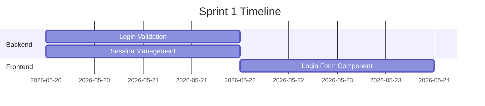

# Option A Implementation: Orchestration & Timeline Preservation
> How to maintain story-level orchestration after eliminating standalone story artifacts

---

## Problem Statement

**Option A eliminates standalone story artifacts** by embedding scenarios directly into requirement documents.

**User concern:** How do we maintain orchestration, timeline, and task coordination that stories currently provide?

---

## Solution: Multi-Level Orchestration

Orchestration happens at **three levels** in Option A:

1. **Scenario-level** (within requirements) — user narrative + acceptance criteria
2. **Task-level** (existing) — implementation units with priority tiers
3. **Milestone-level** (new) — cross-cutting coordination artifact

---

## Level 1: Scenario-Level Orchestration (Within Requirements)

### Requirement Template Enhancement

Embed scenarios directly in requirement documents with **orchestration metadata**:

```yaml
---
id: req-user-authentication
type: requirement
owner: business-analyst
status: draft
version: 1.0
feature: user-authentication
module: user-authentication/login-flow
hard-deps:
  - feat-user-authentication
soft-deps:
  - persona-primary-user
refs:
  - feat-user-authentication
  - persona-primary-user
---

# Requirement: User Authentication

## Problem Statement
Users need secure access to the application with email/password credentials.

## Scope

### In Scope
- Email/password login
- Session management
- Password reset flow

### Out of Scope
- OAuth/SSO integration
- Multi-factor authentication

---

## Functional Requirements

| ID | Requirement | Priority |
|----|-------------|----------|
| F1 | User can log in with email and password | must |
| F2 | System validates credentials against database | must |
| F3 | Failed login attempts are rate-limited | should |
| F4 | User can reset forgotten password via email | must |

---

## Scenarios

### Scenario 1: Successful Login
**Priority:** P0 (launch blocker)  
**Estimated effort:** 3 tasks (2 BE, 1 FE)  
**Dependencies:** None  
**Timeline:** Sprint 1

**Narrative:**
As a **registered user**,
I want to **log in with my email and password**,
so that **I can access my account**.

**Preconditions:**
- User has a registered account
- User is on the login page

**Acceptance Criteria:**
- [ ] Given valid credentials, when user submits login form, then user is redirected to dashboard
- [ ] Given valid credentials, when user logs in, then session token is created
- [ ] Given invalid credentials, when user submits, then error message is displayed

**Error / Edge Cases:**
| Scenario | Expected Behavior |
|----------|-------------------|
| Empty email field | Display "Email is required" |
| Invalid email format | Display "Invalid email format" |
| Wrong password | Display "Invalid credentials" after rate limit check |

---

### Scenario 2: Password Reset Flow
**Priority:** P1 (important, not blocking)  
**Estimated effort:** 4 tasks (3 BE, 1 FE)  
**Dependencies:** Scenario 1 (email service)  
**Timeline:** Sprint 2

**Narrative:**
As a **user who forgot their password**,
I want to **reset my password via email**,
so that **I can regain access to my account**.

**Preconditions:**
- User has a registered account
- User is on the login page

**Acceptance Criteria:**
- [ ] Given registered email, when user requests reset, then reset email is sent
- [ ] Given valid reset token, when user clicks link, then reset form is displayed
- [ ] Given new password, when user submits, then password is updated and user can log in

**Error / Edge Cases:**
| Scenario | Expected Behavior |
|----------|-------------------|
| Unregistered email | Display success message (security: don't reveal account existence) |
| Expired token | Display "Link expired, request new reset" |
| Weak password | Display password strength requirements |

---

## Success Metrics
| Metric | Target |
|--------|--------|
| Login success rate | >95% |
| Password reset completion rate | >80% |

## Constraints
- Session tokens must expire after 24 hours of inactivity
- Password reset tokens expire after 1 hour
- Rate limit: 5 failed login attempts per 15 minutes per IP

## Open Questions
- 
```

**Key additions:**
- **Priority** (P0, P1, P2) per scenario
- **Estimated effort** (task count)
- **Dependencies** (between scenarios)
- **Timeline** (sprint/milestone assignment)

---

## Level 2: Task-Level Orchestration (Enhanced)

### Task Template Enhancement

Tasks already have `priority` (tier) and `depends-on` fields. Enhance with **scenario traceability**:

```yaml
---
id: task-login-validation-be
type: task
owner: backend-engineer
status: open
version: 1.0
feature: user-authentication
module: user-authentication/login-flow
track: backend
priority: 1
scenario: req-user-authentication#scenario-1  # ← NEW: link to specific scenario
milestone: sprint-1                            # ← NEW: timeline assignment
estimated-hours: 8                             # ← NEW: effort estimate
depends-on: []
hard-deps:
  - api-user-authentication
  - dm-user-authentication
soft-deps:
  - adr-session-strategy
refs:
  - api-user-authentication
  - dm-user-authentication
  - adr-session-strategy
  - req-user-authentication
---

# Task: Login Validation (Backend)

## Scope

### Included
- Validate email/password against database
- Generate session token on success
- Return error on failure

### Excluded
- Rate limiting (separate task)
- Password reset logic

## Acceptance Criteria
- [ ] Endpoint `/auth/login` accepts email and password
- [ ] Valid credentials return 200 with session token
- [ ] Invalid credentials return 401 with error message
- [ ] Session token is stored in database with expiry

## Relevant Specs
- api-user-authentication → `POST /auth/login`
- dm-user-authentication → `users` table, `sessions` table
- req-user-authentication → Scenario 1: Successful Login

---

## Implementation Notes
<!-- Filled on completion -->
```

**Key additions:**
- **scenario** — links task to specific scenario in requirement doc
- **milestone** — sprint/phase assignment
- **estimated-hours** — effort estimate for timeline planning

---

## Level 3: Milestone-Level Orchestration (New Artifact)

### New Artifact Type: `milestone`

**Purpose:** Cross-cutting timeline coordination across scenarios and tasks

**Location:** `/milestones/milestone-{name}.md`

**Template:**

```yaml
---
id: milestone-sprint-1
type: milestone
owner: orchestrator
status: draft
version: 1.0
feature: user-authentication
start-date: 2026-05-20
end-date: 2026-06-03
hard-deps: []
soft-deps: []
refs:
  - req-user-authentication
  - task-login-validation-be
  - task-login-form-fe
---

# Milestone: Sprint 1 — Core Authentication

## Objective
Deliver core login functionality (email/password) with session management.

## Scope

### Scenarios Included
| Scenario | Requirement | Priority | Status |
|----------|-------------|----------|--------|
| Successful Login | req-user-authentication#scenario-1 | P0 | in-progress |

### Scenarios Deferred
| Scenario | Requirement | Reason | Target Milestone |
|----------|-------------|--------|------------------|
| Password Reset | req-user-authentication#scenario-2 | Not launch blocker | sprint-2 |

---

## Task Breakdown

### Backend Track
| Task ID | Title | Scenario | Tier | Est. Hours | Status | Owner |
|---------|-------|----------|------|------------|--------|-------|
| task-login-validation-be | Login Validation | scenario-1 | 1 | 8 | open | backend-engineer |
| task-session-mgmt-be | Session Management | scenario-1 | 1 | 6 | open | backend-engineer |

**Backend Total:** 14 hours

### Frontend Track
| Task ID | Title | Scenario | Tier | Est. Hours | Status | Owner |
|---------|-------|----------|------|------------|--------|-------|
| task-login-form-fe | Login Form Component | scenario-1 | 1 | 8 | open | frontend-engineer |

**Frontend Total:** 8 hours

---

## Timeline



---

## Dependencies

### Cross-Track Dependencies
- Frontend task-login-form-fe depends on Backend task-login-validation-be (API contract)

### External Dependencies
- Email service configuration (for future password reset)

---

## Risks

| Risk | Impact | Mitigation |
|------|--------|------------|
| Session token strategy not finalized | High | ADR must be accepted before implementation starts |
| Rate limiting complexity | Medium | Defer to sprint 2 if needed |

---

## Success Criteria
- [ ] All P0 scenarios have passing acceptance criteria
- [ ] All tasks status: done
- [ ] No open CRs blocking deployment
- [ ] Test coverage >80%

---

## Progress Tracking

### Daily Standup Notes
**2026-05-20:**
- Backend: Started task-login-validation-be
- Frontend: Waiting on API contract finalization

**2026-05-21:**
- Backend: task-login-validation-be 50% complete
- Frontend: Started task-login-form-fe

---

## Retrospective
<!-- Filled at milestone completion -->

### What Went Well
- 

### What Could Improve
- 

### Action Items
- 
```

---

## Orchestration Workflow in Option A

### Phase 1: Requirements with Scenarios

**Business Analyst writes:**
1. Requirement document with embedded scenarios
2. Each scenario has:
   - Priority (P0, P1, P2)
   - Estimated effort (task count)
   - Dependencies (between scenarios)
   - Timeline hint (sprint/phase)

**Orchestrator checks:**
- All scenarios have acceptance criteria
- Priorities are assigned
- Dependencies are logical (no cycles)

---

### Phase 2: Design

**UX Designer + Architect:**
- Read requirement scenarios
- Create user-flows, wireframes, component-specs (for UI scenarios)
- Create API contracts, data models (for backend scenarios)
- **Link design artifacts to specific scenarios** in refs

---

### Phase 3: Task Decomposition

**Architect + Engineers:**
1. Read requirement scenarios
2. Create tasks per scenario
3. **Link each task to its scenario** via `scenario` field
4. Assign priority tiers based on scenario dependencies
5. Estimate hours per task

**Orchestrator:**
1. Groups tasks by scenario
2. Calculates total effort per scenario
3. Validates scenario dependencies match task dependencies
4. **Proposes milestone breakdown** (optional)

**Gate 3 presents:**
```
Scenario: Successful Login (req-user-authentication#scenario-1)
  Priority: P0 | Est. effort: 3 tasks (14 hours) | Sprint 1

  Backend Tasks (Tier 1):
    - task-login-validation-be (8h)
    - task-session-mgmt-be (6h)

  Frontend Tasks (Tier 1):
    - task-login-form-fe (8h)

Scenario: Password Reset (req-user-authentication#scenario-2)
  Priority: P1 | Est. effort: 4 tasks (20 hours) | Sprint 2
  Dependencies: Scenario 1 (email service)

  Backend Tasks (Tier 1):
    - task-reset-request-be (6h)
    - task-reset-token-be (8h)
    - task-reset-confirm-be (4h)

  Frontend Tasks (Tier 1):
    - task-reset-form-fe (6h)
```

---

### Phase 4: Implementation

**Engineers:**
- Implement tasks tier by tier
- Update task status (open → in-progress → done)
- Fill implementation notes on completion

**Orchestrator tracks:**
- Scenario completion (all tasks for scenario done)
- Milestone progress (if milestones defined)
- Cross-scenario dependencies

**Progress view:**
```
Sprint 1 Progress:

Scenario 1: Successful Login [P0]
  Backend: ████████░░ 80% (2/2 tasks done, 1 in review)
  Frontend: ██████████ 100% (1/1 tasks done)
  Overall: ████████░░ 90%

Scenario 2: Password Reset [P1] — Deferred to Sprint 2
  Backend: ░░░░░░░░░░ 0%
  Frontend: ░░░░░░░░░░ 0%
```

---

### Phase 5: Deployment

**DevOps:**
- Reads completed scenarios from requirement docs
- Reads completed tasks
- Creates infra plan

**Orchestrator:**
- Surfaces which scenarios are deployed vs deferred
- Links deferred scenarios to future milestones

---

## Comparison: Current vs Option A

### Current (with standalone stories)

```
Orchestration points:
1. Story artifacts (independent files)
   - Each story has priority, dependencies
   - Stories listed in requirement doc
   - Tasks link to stories

2. Task artifacts
   - Tasks have priority tiers
   - Tasks link to stories

3. Task-breakdown (for CR-driven work)
   - Coordinates phased task sets
```

**Pros:**
- Stories independently versionable
- Granular traceability (task → story → requirement)

**Cons:**
- Redundancy (story AC vs requirement AC vs task AC)
- Extra artifact type to maintain
- Longer dependency chains

---

### Option A (scenarios in requirements)

```
Orchestration points:
1. Scenarios (embedded in requirements)
   - Each scenario has priority, effort, dependencies, timeline
   - Scenarios numbered/anchored (scenario-1, scenario-2)
   - Tasks link to scenarios via anchor

2. Task artifacts (enhanced)
   - Tasks have priority tiers (existing)
   - Tasks link to scenarios (new: scenario field)
   - Tasks have milestone assignment (new)
   - Tasks have effort estimates (new)

3. Milestone artifacts (new, optional)
   - Cross-cutting timeline coordination
   - Aggregates scenarios + tasks
   - Tracks progress, risks, dependencies
```

**Pros:**
- Scenarios stay close to requirements (context preserved)
- No redundant artifact type
- Milestone artifact provides high-level orchestration view
- Shorter dependency chains

**Cons:**
- Scenarios not independently versionable (version whole requirement)
- Slightly larger requirement documents

---

## Migration Path

### Step 1: Update Templates

**1.1 Requirement Template**
- Add "Scenarios" section with orchestration fields
- Each scenario gets: priority, effort, dependencies, timeline

**1.2 Task Template**
- Add `scenario` field (links to requirement#scenario-N)
- Add `milestone` field (optional sprint/phase assignment)
- Add `estimated-hours` field

**1.3 Create Milestone Template**
- New artifact type for cross-cutting coordination
- Optional — only create when needed for complex features

---

### Step 2: Update Reference Docs

**2.1 Artifact Vocabulary**
- Remove `story` definition
- Add `scenario` definition (embedded in requirement)
- Add `milestone` definition (optional coordination artifact)

**2.2 Dependency Graph**
- Remove story from graph
- Update: requirement → api-contract/component-spec → task
- Add milestone as optional coordination layer (doesn't block, informational)

**2.3 Artifact Lifecycle**
- Remove story lifecycle
- Clarify: scenarios version with their parent requirement

---

### Step 3: Update Agent Handbooks

**3.1 Business Analyst**
- Write scenarios directly in requirement docs
- Assign priority, effort, dependencies, timeline per scenario
- No longer create standalone story files

**3.2 Orchestrator**
- Read scenarios from requirement docs (not separate files)
- Generate milestone artifacts when requested
- Track scenario completion via task status

**3.3 Engineers**
- Link tasks to scenarios via `scenario` field
- Read scenario acceptance criteria from requirement docs

---

### Step 4: Update Registry

**4.1 Add to `_registry.md`:**
```markdown
## Artifact Types

| Type | Prefix | Owner | Purpose |
|------|--------|-------|---------|
| milestone | milestone- | orchestrator | Timeline coordination (optional) |
```

**4.2 Mark story as deprecated:**
```markdown
| Type | Prefix | Owner | Purpose | Status |
|------|--------|-------|---------|--------|
| story | story- | business-analyst | User narrative | **DEPRECATED** — use scenarios in requirements |
```

---

### Step 5: Migrate Existing Stories

**For each existing story artifact:**

1. Identify parent requirement
2. Copy story content into requirement doc as new scenario section
3. Add orchestration metadata (priority, effort, dependencies, timeline)
4. Update task refs: `story-{slug}` → `req-{slug}#scenario-N`
5. Archive story file (keep for audit trail)

**Example migration:**

**Before:**
```
/requirements/req-user-authentication.md
/stories/story-successful-login.md
/stories/story-password-reset.md
/tasks/task-login-validation-be.md (refs: story-successful-login)
```

**After:**
```
/requirements/req-user-authentication.md (now includes scenario-1, scenario-2)
/tasks/task-login-validation-be.md (refs: req-user-authentication#scenario-1)
```

---

## Orchestrator Queries for Option A

### Find all scenarios for a feature
```bash
# Read requirement docs for feature
rg -l "feature: user-authentication" requirements/

# Extract scenarios from each requirement
# (scenarios are markdown sections within the doc)
```

### Find all tasks for a scenario
```bash
# Query tasks by scenario field
rg -l "scenario: req-user-authentication#scenario-1" tasks/
```

### Calculate scenario completion
```bash
# Find all tasks for scenario
rg -l "scenario: req-user-authentication#scenario-1" tasks/

# Check status of each task
rg "status: done" tasks/task-*-scenario-1*.md | wc -l
```

### Generate milestone progress report
```bash
# Read milestone doc
cat milestones/milestone-sprint-1.md

# For each task in milestone, check status
# Calculate completion percentage
```

---

## Recommendation Summary

**Option A with orchestration enhancements provides:**

1. **Scenario-level orchestration** — embedded in requirements with priority, effort, dependencies, timeline
2. **Task-level orchestration** — enhanced with scenario links, milestones, effort estimates
3. **Milestone-level orchestration** — optional new artifact for cross-cutting coordination

**Benefits over current approach:**
- Eliminates story/requirement redundancy
- Maintains all orchestration capabilities
- Adds milestone artifact for high-level timeline view
- Shorter dependency chains (4 levels vs 5)
- Scenarios stay close to requirements (better context)

**Trade-offs:**
- Scenarios not independently versionable (version with requirement)
- Slightly larger requirement documents
- One new artifact type (milestone) — but optional

**When to create milestones:**
- Complex features with multiple sprints
- Cross-team coordination needed
- Timeline tracking is critical
- Skip for simple features (scenarios + tasks sufficient)

---

## Next Steps

1. **Approve Option A with orchestration approach**
2. **Update templates** (requirement, task, milestone)
3. **Update reference docs** (vocabulary, dependency graph)
4. **Update agent handbooks** (BA, orchestrator, engineers)
5. **Migrate existing stories** to requirement scenarios
6. **Test with one feature** end-to-end
