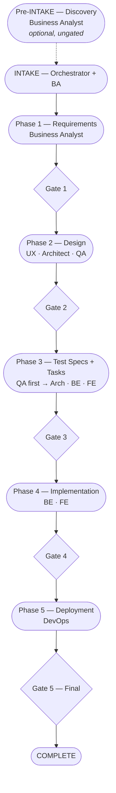
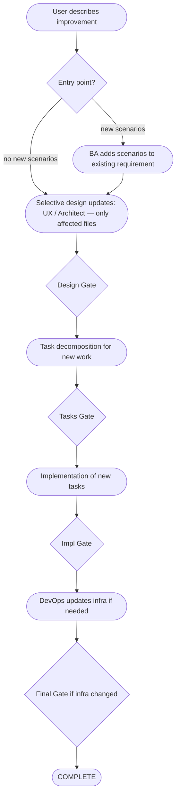
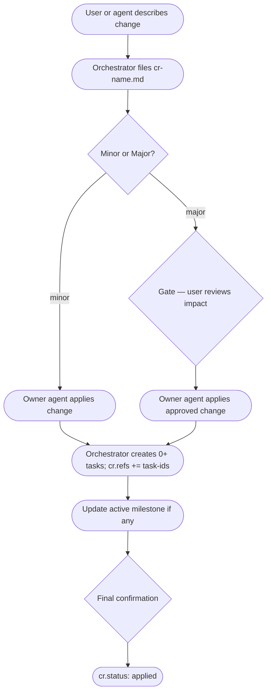

# SDLC Agent Workflow
> Large feature, medium, and small/change-request tracks. For the artifact dependency model that underlies these phases, see `artifact-dependency-graph.md`. For QA / TDD mechanics, see `tdd-workflow.md`.

## Overall Flow (Large Track)



At each gate the user can **approve · refine · reject · proceed with concern**. Proceeding past a noted gap creates an advisory so the concern isn't forgotten.

---

## Actors

| Actor | Role |
|---|---|
| User | Initiates work, approves/refines/rejects at gates, natural language |
| Orchestrator | Routes tasks, surfaces convention gaps, guides when needed, stamps PKM |
| Agents | Produce artifacts within their ownership domain |
| PKM | Passive storage — status fields as state, filesystem as rollback |

For the agent roster and ownership map, see `../reference/artifact-ownership.md` and `../reference/sdlc-phases.md`.

## Orchestrator Modes

| Mode | When | Behavior |
|---|---|---|
| Direct | User knows what they want | Confirm understanding, execute |
| Guided | User unsure of next step | Propose next step, explain why, wait |
| Convention | Before every phase transition | Surface gaps and missing references to the user |

## Convention Check Rules

Gaps the orchestrator surfaces — **none are auto-blocking**. The user decides whether to act, defer, or proceed.

- **Important** (typically worth resolving): required artifact missing · frontmatter incomplete · ref to non-existent document · artifact type not in registry
- **Worth noting** (flag, then proceed): expected upstream still draft · related decision not yet accepted · downstream may conflict with unresolved item

When the user chooses to proceed past a noted gap, capture it as an advisory.

## Track Selection

Track is determined by **impact depth**, not manual classification. The orchestrator identifies the entry-point artifact, traverses the dependency graph backward and forward, and counts how many artifact layers are affected. For the impact-depth → track table, see `../reference/sdlc-phases.md#track-selection`.

---

## LARGE FEATURE TRACK

Full waterfall SDLC from discovery to deployment. User triggers each phase explicitly and approves at every gate.

### Pre-INTAKE — Discovery *(optional, ungated)*
**Agent**: Business Analyst — see `agent-roles.md#business-analyst-agent` for reads/writes.

Discovery artifacts are **not phase-bound**. The BA may produce them at any time (proactively from user research, or on demand when INTAKE references an audience that has no persona yet). No gate, no formal trigger. INTAKE simply references whichever discovery artifacts already exist; missing personas can be created during Phase 1 or noted as advisories.

### INTAKE
**Agents**: Orchestrator (classifies) + Business Analyst (writes feature). Output: `features/feat-{name}.md`.

1. User describes the feature in natural language.
2. Orchestrator classifies as large track and scans PKM for related personas, research, and features.
3. Orchestrator confirms understanding with the user (direct mode if intent is clear; one clarifying question if ambiguous).
4. BA writes `features/feat-{name}.md` referencing relevant personas / research-notes.

### Phase 1 — Requirements
**Agent**: Business Analyst. Output: `requirements/req-{name}.md`.

1. Orchestrator activates BA with research + persona context.
2. BA drafts the requirement: scope, out-of-scope, user context, success metrics.
3. BA writes scenarios directly in the requirement (priority, estimated effort, dependencies, timeline, narrative, acceptance criteria, error/edge cases).

**Convention check**: frontmatter complete and registry-valid · all refs resolve · ≥1 scenario with acceptance criteria · scope + out-of-scope both defined · each scenario has priority.

**Gate 1** — Orchestrator presents requirement summary + scenario list → approve / refine / reject.

### Phase 2 — Design
**Agents**: UX-UI Designer, Software Architect, QA Engineer
**Sequencing**: sequential by default; parallel on user request.

#### UX-UI Designer
Outputs: `user-flows/`, `wireframes/`, `component-specs/`.

1. **User flows** — embedded Mermaid; happy path + error/edge paths; entry/exit points. Reads requirements + personas.
2. **Wireframes** — one self-contained HTML file per screen, browser-previewable. Reads user flows.
3. **Component specs** — states (default/hover/loading/error/disabled), variants, behavior, design tokens, accessibility. Reads wireframes; refs wireframe + user flow.

#### Software Architect
Outputs: `quality-requirements/`, `architecture-decisions/` (optional), `api-contracts/`, `data-models/`.

1. **Quality requirements** — latency targets, uptime SLAs, scalability limits, security requirements. Drafted first because they constrain every choice that follows.
2. **ADRs** — only when the technical choice is significant. Context, decision, alternatives rejected, consequences.
3. **API contracts** — endpoints, request/response shapes, error codes. Refs relevant ADRs when they exist.
4. **Data models** — schema, indexes, migration notes. Refs API contract.

#### QA Engineer
Output: `test-plans/tp-{name}.md`.

- Testing strategy, scope, test levels (unit/integration/e2e), coverage targets, entry/exit criteria, risk assessment, list of test-specs to produce in Phase 3.
- Can run in parallel with UX and Architect.

**Convention check**: wireframe per screen in flow · component spec per wireframe · ADRs for significant choices · API contract refs ADRs when present · data model refs API contract · test plan exists · all refs resolve.

**Gate 2** — UX artifacts + architecture artifacts + test plan. Warnings flagged alongside artifacts → approve / refine / reject.

### Phase 3 — Test Specs & Task Decomposition
**Agents**: QA Engineer (first), then Architect + Backend + Frontend

#### QA Engineer (runs first)
Outputs: `test-specs/`, `test-suites/`.

1. **Test specs** — one per scenario. Frontmatter `scenario: req-{slug}#scenario-{N}`. Given/When/Then cases, edge/error cases, mocking strategy, coverage target.
2. **Test suites** — group related specs. Coverage goals (line/branch/function), shared fixtures, run commands, CI integration.

**Convention check (QA)**: test spec per scenario in accepted requirements · test suite groups related specs · coverage targets defined · missing test spec → advisory (does not block).

#### Architect / Backend / Frontend (after test specs drafted)
Output: `tasks/task-{name}-{be|fe}.md`.

- Each task carries: `priority` (tier number), `depends-on: [task-id, ...]`, scope (included/excluded), criteria (testable AC), `refs: [api-{slug}, dm-{slug}, ts-{slug}, ...]`, `scenario: req-{slug}#scenario-{N}`.
- Architect decomposes backend tasks (reads api-contracts, data-models, requirements, test-specs).
- Frontend decomposes frontend tasks (reads component-specs, api-contracts, test-specs).

Orchestrator builds a dependency graph from `depends-on` and groups tasks into priority tiers per track. Same-tier tasks within a track can run in parallel.

**Gate 3** — test specs + test suites + task board (BE + FE tiers). User may add, remove, or adjust tasks → approve / refine / reject.

### Phase 4 — Implementation
**Agents**: Backend Engineer, Frontend Engineer
**Sequencing**: sequential by default (backend → frontend); parallel on user request.

For each task with test-specs in `refs`, engineers follow the **TDD cycle** (red → green → refactor → done + Implementation Notes → QA accepts spec). Full mechanics: see `tdd-workflow.md#tdd-cycle-per-task`.

**Cross-cutting during Phase 4**:
- Engineers file a CR when they find a gap in an upstream artifact (see [CR Routing Rules](#cr-routing-rules) below).
- QA marks test-specs `accepted` as their cases pass; test-suite `accepted` when all included specs are accepted.

**Convention check**: all tasks `done` or explicitly deferred · open CRs resolved or deferred · deferred CRs have advisories · test-specs still draft → advisory.

**Gate 4** — tasks completed + test coverage summary + open CRs + deferred items → approve / refine / reject.

### Phase 5 — Deployment
**Agent**: DevOps Engineer. Output: `infra/infra-{name}.md`.

- IaC specification, CI/CD pipeline config, monitoring + alerting setup, rollout strategy (canary / direct), on-call runbook.
- Orchestrator surfaces all deferred CRs and open advisories alongside the infra plan so the user has the full picture before final approval.

**Gate 5 — Final** — infra plan + complete deferred items list → approve / refine / reject.

**On approval**: `features/feat-{name}.md` → `accepted`. All phase artifacts versioned and accepted in PKM. Deferred items remain open in `change-requests/`.

---

## MEDIUM TRACK

For improvements or additions to an existing feature. Skips discovery and design — enters at requirements or task level.



### How it works

1. User describes the improvement (e.g. "add SMS fallback to password reset").
2. Orchestrator identifies the affected feature and confirms scope.
3. Entry point:
   - If existing scenarios cover the change → enter at **task decomposition**.
   - If new scenarios are needed → enter at **requirements** (BA adds scenarios to existing requirement, bumps version).
4. **Selective design updates** only for what changed:
   - UI changes → UX updates affected user flows / wireframes / component specs.
   - API changes → Architect updates contract directly (if owner) or files a CR.
   - No UI/API gap → skip to task decomposition.
5. **Tasks**: decompose only new work.
6. **Implementation**: same TDD process as large track Phase 4.
7. **Infra**: DevOps updates only if deployment changes are needed.

Each step has its own gate. Skip the infra gate if no infra changes were made.

**On completion**: affected artifacts versioned and accepted; feature document updated with new scope.

---

## SMALL TRACK — Change Request

Targeted correction to an existing artifact. Single gate. No phase sequence.



### How it works

1. User describes the change (or a downstream agent files a CR automatically during implementation).
2. Orchestrator locates the target artifact and its owner; creates `change-requests/cr-{name}.md` with `refs: [target, related artifacts, triggering task]` and body (problem, proposed change, justification, impact).
3. Orchestrator routes to the artifact owner.
4. **Minor CR** (non-breaking, additive): owner applies the change directly.
5. **Major CR** (breaking, cross-cutting): orchestrator presents impact to user first → approve / refine / reject. Owner applies on approval.
6. Orchestrator creates the 0, 1, or many tasks needed to carry out the CR; appends them to `cr.refs`. If no implementation is needed, no tasks are created.
7. If an active milestone exists, the milestone's `refs` is updated to include the CR and any new tasks.

**Gate (final)** — orchestrator confirms the change applied, shows diff summary and tasks created → approve / refine.

**On completion**:
- `cr.status: applied`
- target artifact version bumped
- related artifacts may be flagged `status: needs-review`
- `cr.refs` contains target + any resulting task ids
- milestone updated if one exists

---

## Agent Activation Order

```
Intake
  └── Orchestrator

Phase 1
  └── Business Analyst

Phase 2 (sequential default)
  ├── UX-UI Designer
  ├── Software Architect
  └── QA Engineer          (test-plan — can run parallel with UX/Arch)

Phase 3
  ├── QA Engineer          (test-specs + test-suites — first, using Phase 2 output)
  ├── Software Architect   (backend task decomposition — after test-specs drafted)
  ├── Backend Engineer     (backend task decomposition)
  └── Frontend Engineer    (frontend task decomposition)

Phase 4 (sequential default)
  ├── Backend Engineer
  └── Frontend Engineer

Phase 5
  └── DevOps Engineer
```

### Parallel Execution Windows
```
Phase 2: UX-UI Designer ‖ Software Architect ‖ QA Engineer  (user-triggered)
Phase 3: QA Engineer → then Arch/BE/FE in parallel           (QA must go first)
Phase 4: Backend Engineer ‖ Frontend Engineer                (user-triggered)
```

Parallel execution only when:
1. User explicitly triggers it
2. No blocking dependency between the two agents at that point
3. Tasks have been clearly decomposed with explicit scope boundaries

QA Engineer in Phase 3 runs **before** task decomposition so that tasks can reference existing test-specs in their `refs`. Task decomposition does not wait for test-suites — suites may be completed concurrently with early task decomposition.

---

## CR Routing Rules

When an agent finds a gap in an upstream artifact during implementation, it files a CR (template: `../templates/change-request.md`) with:

```
target      : artifact with the gap
also-affects: other artifacts impacted (in refs)
triggered-by: triggering task id (in refs)
resulted-in : (filled by orchestrator on resolution, appended to refs)
```

Routing depends on impact:

| Class | Definition | Behavior |
|---|---|---|
| **Minor** | Additive, non-breaking | File CR and proceed optimistically. Owner has a 24h window to object; auto-applied if no response. Task `blocked-by: []`. |
| **Major** | Breaking or cross-cutting | File CR and hard-block. Task `blocked-by: [cr-id]`. Do not proceed until owner resolves; orchestrator presents impact to user before owner applies. |

User can override either default at any time.

---

## Deferred Items Handling

When the user proceeds past a warning:

1. Orchestrator creates `advisories/adv-{concern}.md` capturing what was skipped, which artifact, and the suggested action.
2. Work continues.
3. At Gate 5 (or on user request), the orchestrator surfaces all open advisories and CRs as a **deferred items list**.
4. User chooses per item:
   - **Resolve now** → routes to small track (CR flow) for targeted fix.
   - **Keep deferred** → advisory remains open; CR stays `deferred`; feature can still be `accepted` with open items noted.

---

## PKM Writes & Test Anchors

For the per-phase PKM write summary and test-artifact phase anchors, see `../reference/sdlc-phases.md` (sections "PKM Writes Per Phase" and "QA Phase Anchors").
