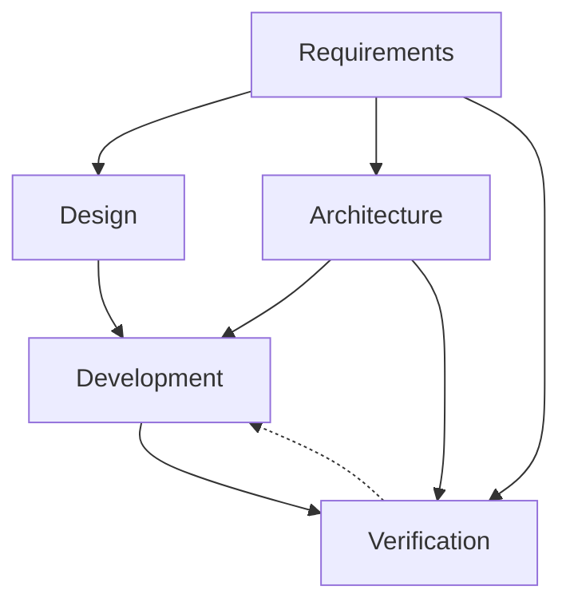

# Artifact Dependency Graph
> Phases, agents, artifact dependencies, creation order. Visualized: `../handbook/sdlc-swimlane-graph.html`.

## Roles & Alternatives

Some artifact types are interchangeable — they share a **role**. A feature picks **one** type per role as its root/plan. The dependency graph below references roles (not specific type names) wherever alternatives exist.

| Role | Default type | Alternatives |
|---|---|---|
| `requirements-root` | `feature-brief` | `prd`, `pitch`, `one-pager`, `press-release` |
| `plan` | `plan` | `work-breakdown-structure`, `implementation-plan` |

Other roles (`requirement`, `design`, `architecture`, `development`, `verification`) currently have a single type each; the role field still lets future alternatives slot in without graph changes. The authoritative type→role map lives in `../manifest.yaml` under `types`.

## Phases

| Phase | Question | Agents | Artifacts |
|---|---|---|---|
| 1 — Requirements | What are we building and for whom? | project-manager, business-analyst | requirements-root (one of: feature-brief, prd, pitch, one-pager, press-release), user-story |
| 2 — Design | How does the user experience it? | product-designer | user-flow, design-spec |
| 3 — Architecture | How is it structured? | software-architect | adr, system-architecture, api-spec, data-design |
| 4 — Development | How is it built? | backend-engineer, frontend-engineer | tech-design, task, plan (one of: plan, work-breakdown-structure, implementation-plan) |
| 5 — Verification | How do we know it works? | qa-engineer | test-spec |

## Phase Flow



Solid = produces; dashed = feedback/refines.

## Interaction Types

| Type | Symbol | Meaning |
|---|---|---|
| Produces | `A → B` | A required before B |
| Refines | `A ↩ B` | B exposes gap in A; revise A |
| Constrains | `A ⊳ B` | A bounds B's valid shape |
| Co-evolves | `A ↔ B` | iterated together |

## Dependencies

```mermaid
graph LR
    subgraph REQ[Requirements]
        ROOT["requirements-root<br/>(fb | prd | pitch | op | pr)"] --> STORY[user-story]
    end
    subgraph DES[Design]
        UF[user-flow] --> DS[design-spec]
    end
    subgraph ARC[Architecture]
        SA[system-architecture] --> ADR[adr]
        SA[system-architecture] --> API[api-spec]
        SA --> DD[data-design]
        API ↔ DD
    end
    subgraph DEV[Development]
        TD[tech-design] --> TASK[task]
        TD --> PLAN["plan<br/>(plan | wbs | ip)"]
        STORY --> PLAN
    end
    subgraph VER[Verification]
        TS[test-spec]
    end
```

| To create… | First create… |
|---|---|
| requirements-root (feature-brief, prd, pitch, one-pager, press-release) | — |
| user-story | requirements-root |
| user-flow | requirements-root |
| design-spec | user-flow |
| system-architecture | requirements-root |
| adr | system-architecture |
| api-spec | system-architecture |
| data-design | system-architecture |
| tech-design | system-architecture, requirements-root |
| task | tech-design |
| plan (plan, work-breakdown-structure, implementation-plan) | tech-design, user-story |
| test-spec | api-spec, user-story |
| note | — |

*Ad-hoc artifacts like `note` can be created at any time, by any agent, without phase or prerequisite restrictions.*

*`api-spec` and `data-design` co-evolve (`↔`): both depend on `system-architecture`, but they iterate together — API shapes reference data-design entities, and data-design internal shapes are constrained by API contracts.*

Cross-refs live in `refs` frontmatter. See `artifact-frontmatter.md`.
