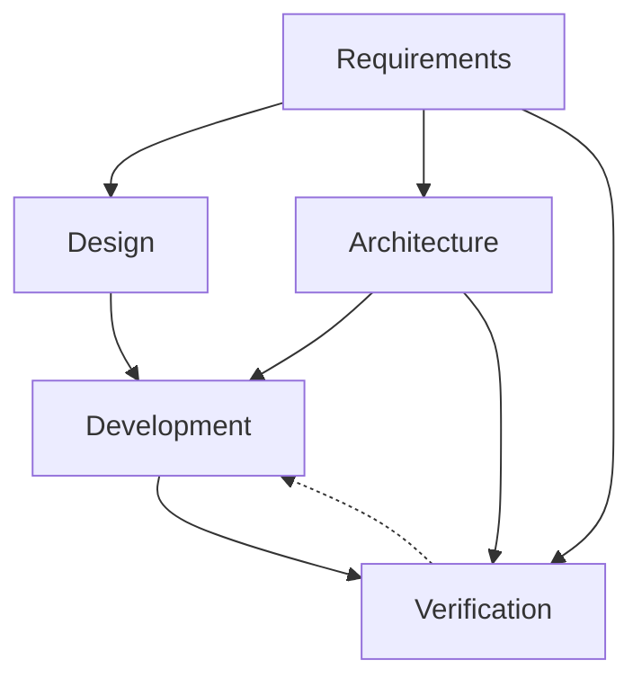

# Artifact Dependency Graph
> Phases, agents, artifact dependencies, creation order.

## Phases

| Phase | Question | Agents | Artifacts |
|---|---|---|---|
| 1 — Requirements | What are we building and for whom? | project-manager, business-analyst | prd, user-story |
| 2 — Design | How does the user experience it? | product-designer | user-flow, design-spec |
| 3 — Architecture | How is it structured? | software-architect | adr, system-architecture, api-spec, data-design, tech-design |
| 4 — Development | How is it built? | backend-engineer, frontend-engineer, project-manager | task, plan |
| 5 — Verification | How do we know it works? | qa-engineer | test-spec |

## Phase Flow

Solid = produces; dashed = feedback/refines.

## Interaction Types

| Type | Symbol | Meaning |
|---|---|---|
| Produces | `A → B` | A required before B |
| Refines | `A ↩ B` | B exposes gap in A; revise A |
| Constrains | `A ⊳ B` | A bounds B's valid shape |
| Co-evolves | `A ↔ B` | iterated together |

## Dependencies

```mermaid
graph LR
    subgraph REQ[Requirements]
        ROOT["prd"] --> STORY[user-story]
    end
    subgraph DES[Design]
        UF[user-flow] --> DS[design-spec]
    end
    subgraph ARC[Architecture]
        SA[system-architecture] --> ADR[adr]
        SA --> API[api-spec]
        SA --> DD[data-design]
        API <--> DD
        SA <--> TD[tech-design]
    end
    subgraph DEV[Development]
        TD --> TASK[task]
        TD --> PLAN["plan"]
        STORY --> PLAN
    end
    subgraph VER[Verification]
        TS[test-spec]
    end

    ROOT --> SA
    ROOT --> TD
```

| To create… | First create… |
|---|---|
| prd | — |
| user-story | prd |
| user-flow | prd |
| design-spec | user-flow |
| system-architecture | prd (or tech-design if bottom-up) |
| adr | system-architecture (or tech-design if bottom-up) |
| api-spec | system-architecture (or tech-design if bottom-up) |
| data-design | system-architecture (or tech-design if bottom-up) |
| tech-design | prd (and optionally system-architecture if top-down) |
| task | tech-design |
| plan | tech-design, user-story |
| test-spec | api-spec, user-story |
| note | — |

*Ad-hoc artifacts like `note` can be created at any time, by any agent, without phase or prerequisite restrictions.*

*Requirements-root alternatives are customization selectable — see `../handbook/customization.md` and `../handbook/customizations/README.md`. An alternative shares the default type's dependencies shown above. The graph depicts `prd` (the framework's shipped default); the active type for this vault is in `../manifest.yaml`'s `feature_type:` field — substitute it throughout when reading.*

*`api-spec` and `data-design` co-evolve (`↔`): both depend on `system-architecture`, but they iterate together — API shapes reference data-design entities, and data-design internal shapes are constrained by API contracts.*

Cross-refs live in `refs` frontmatter. See `artifact-frontmatter.md`.
