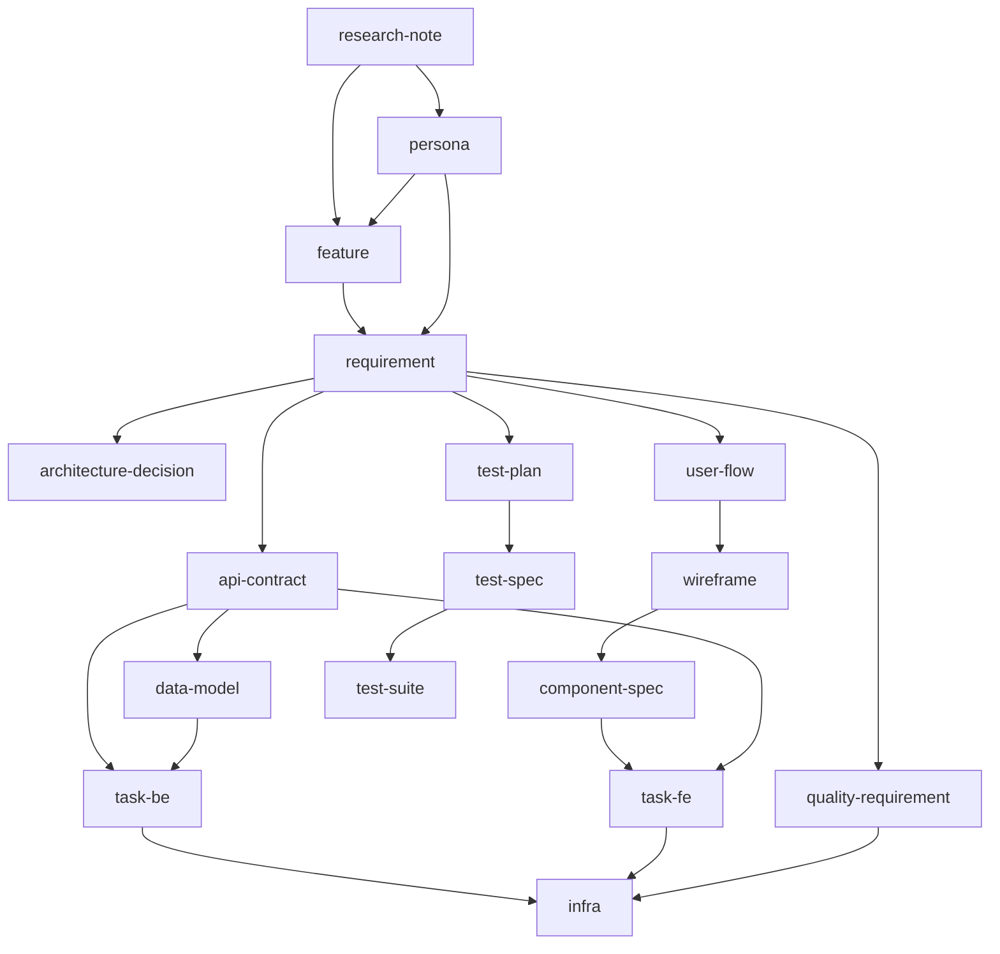

# Artifact Creation Order — Quick Reference
> Suggested order for creating artifacts. Not enforced.

## Graph

## Creation Order Table

| To create… | First create one or more of… |
|---|---|
| persona | research-note |
| feature | (none — entry point) |
| requirement | feature |
| quality-requirement | requirement |
| architecture-decision | requirement |
| user-flow | requirement |
| wireframe | user-flow |
| component-spec | wireframe |
| api-contract | requirement |
| data-model | api-contract |
| test-plan | requirement |
| test-spec | requirement (+ test-plan) |
| test-suite | test-spec |
| task (backend) | api-contract, data-model, requirement |
| task (frontend) | component-spec, api-contract |
| infra | tasks complete + quality-requirement |
| change-request | target artifact |
| advisory | (none — note of a future concern) |
| milestone | (none — coordination overlay) |

All cross-references live in the `refs` frontmatter field. See `artifact-frontmatter.md`.
