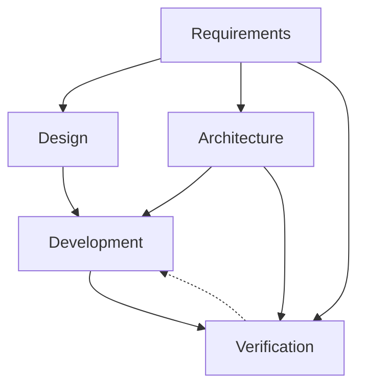
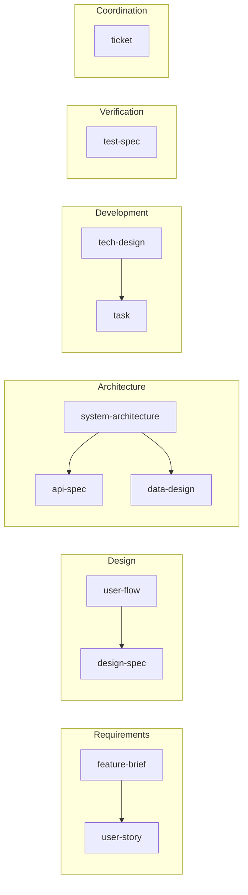

# Artifact Dependency Graph
> Phases, agents, artifact dependencies, creation order. Visualized: `../handbook/sdlc-swimlane-graph.html`.

## Phases

| Phase | Question | Agents | Artifacts |
|---|---|---|---|
| 1 — Requirements | What are we building and for whom? | project-manager, business-analyst | feature-brief, user-story |
| 2 — Design | How does the user experience it? | product-designer | user-flow, design-spec |
| 3 — Architecture | How is it structured? | software-architect | system-architecture, api-spec, data-design |
| 4 — Development | How is it built? | backend-engineer, frontend-engineer | tech-design, task |
| 5 — Verification | How do we know it works? | qa-engineer | test-spec |
| COORDINATION | Cross-cutting coordination | project-manager | ticket |

## Phase Flow

Solid = produces; dashed = feedback/refines.

## Interaction Types

| Type | Symbol | Meaning |
|---|---|---|
| Produces | `A → B` | A required before B |
| Refines | `A ↩ B` | B exposes gap in A; revise A |
| Constrains | `A ⊳ B` | A bounds B's valid shape |
| Co-evolves | `A ↔ B` | iterated together |

## Dependencies

| To create… | First create… |
|---|---|
| feature-brief | — |
| user-story | feature-brief |
| user-flow | feature-brief |
| design-spec | user-flow |
| system-architecture | feature-brief |
| api-spec | system-architecture |
| data-design | system-architecture |
| tech-design | system-architecture, feature-brief |
| task | tech-design |
| test-spec | api-spec, user-story |
| ticket | — |

Cross-refs live in `refs` frontmatter. See `artifact-frontmatter.md`.
