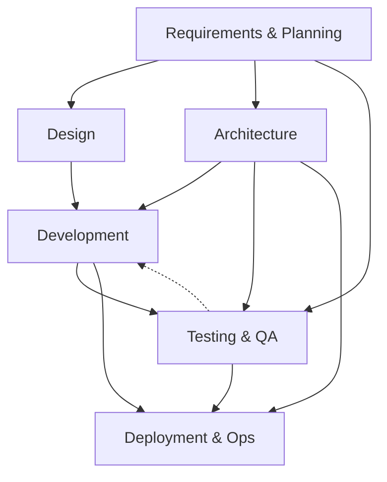
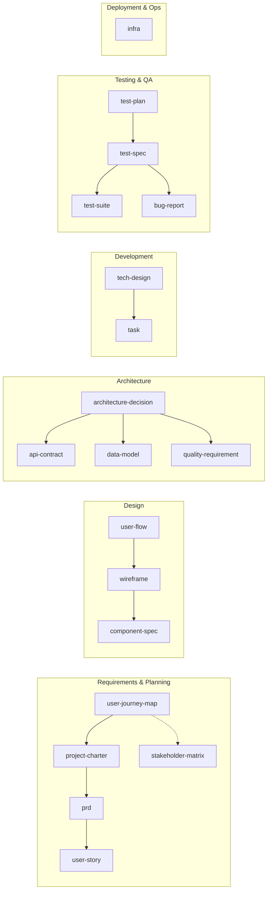

# Artifact Dependency Graph
> Phases, agents, artifact dependencies, creation order. Visualized: `../handbook/sdlc-swimlane-graph.html`.

## Phases

| Phase | Question | Agents | Artifacts |
|---|---|---|---|
| 1 — Requirements & Planning | What are we building and for whom? | business-analyst, product-owner, ux-designer | user-journey-map, project-charter, prd, user-story, stakeholder-matrix |
| 2 — Design | How does the user experience it? | ux-designer, ui-designer | user-flow, wireframe, component-spec |
| 3 — Architecture | How is it structured? | software-architect, backend-engineer | architecture-decision, api-contract, data-model, quality-requirement |
| 4 — Development | How is it built? | backend-engineer, frontend-engineer | tech-design, task |
| 5 — Testing & QA | How do we know it works? | qa-engineer, ux-designer | test-plan, test-spec, test-suite, bug-report |
| 6 — Deployment & Ops | How do we run it? | devops-engineer, incident-commander | infra |
| WORKFLOW | Cross-cutting coordination | — | change-request, advisory, milestone |

## Phase Flow

Solid = produces; dashed = feedback/refines.

## Interaction Types

| Type | Symbol | Meaning |
|---|---|---|
| Produces | `A → B` | A required before B |
| Refines | `A ↩ B` | B exposes gap in A; revise A |
| Constrains | `A ⊳ B` | A bounds B's valid shape |
| Co-evolves | `A ↔ B` | iterated together |

## Dependencies

| To create… | First create… |
|---|---|
| project-charter | user-journey-map |
| prd | project-charter |
| user-story | prd |
| stakeholder-matrix | project-charter |
| user-flow | prd, user-journey-map |
| wireframe | user-flow |
| component-spec | wireframe |
| architecture-decision | prd |
| api-contract | architecture-decision |
| data-model | architecture-decision |
| quality-requirement | prd, architecture-decision |
| tech-design | architecture-decision, prd |
| task | tech-design |
| test-plan | quality-requirement |
| test-spec | test-plan, api-contract, user-story |
| test-suite | test-spec |
| infra | architecture-decision |
| bug-report | test-spec |

Cross-refs live in `refs` frontmatter. See `artifact-frontmatter.md`.
