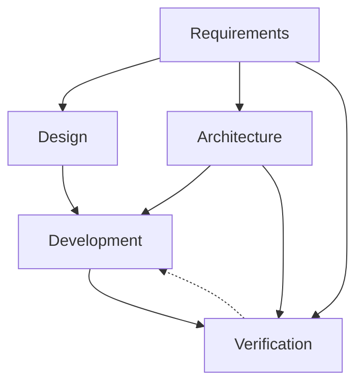
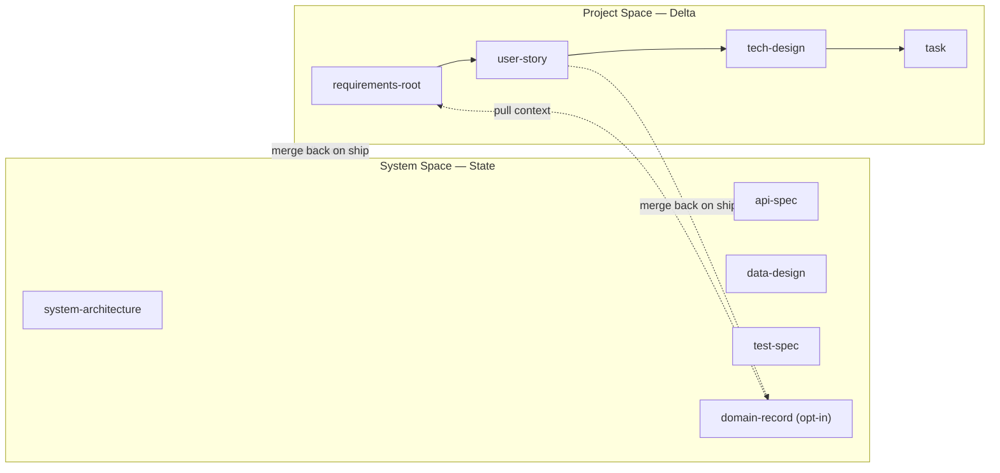
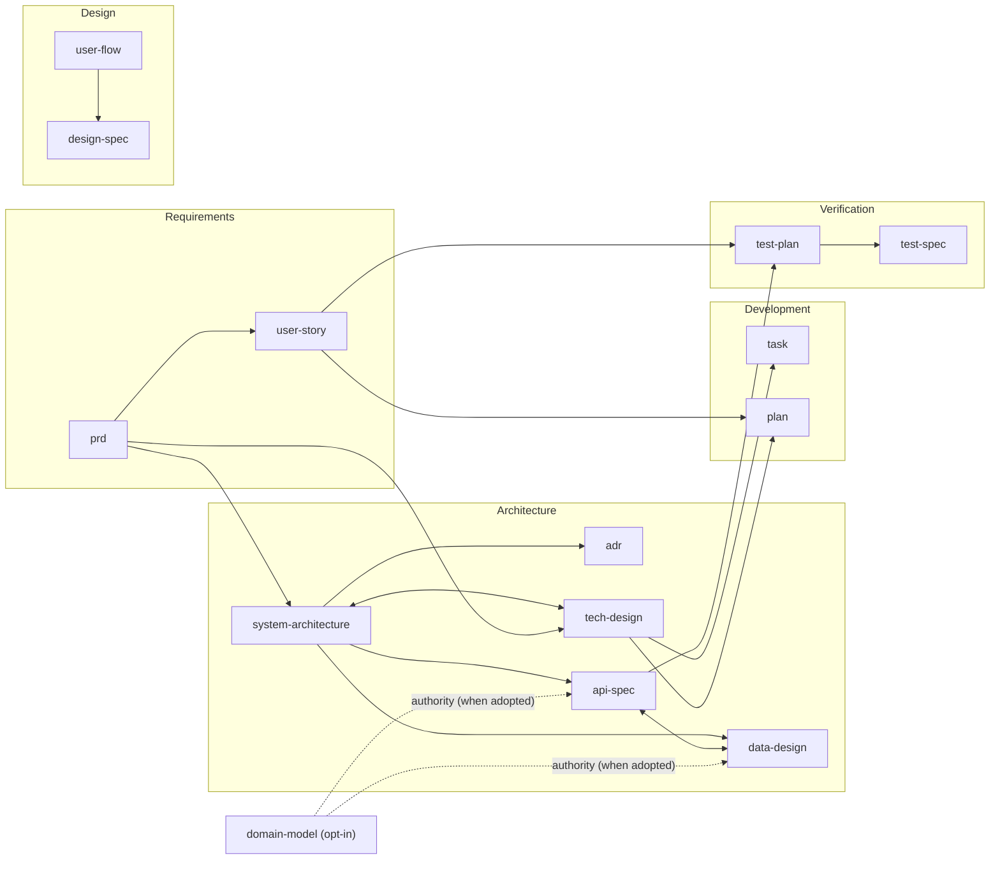

# Artifact Dependency Graph
> Phases, agents, artifact dependencies, creation order.

## Phases

| Phase | Question | Agents | Artifacts | Lifespan | Scope |
|---|---|---|---|---|---|
| 0 — Domain Record *(optional)* | What does this domain do today? | business-analyst / software-architect | system-capability *or* domain-model | State | Domain |
| 1 — Requirements | What are we building and for whom? | project-manager, business-analyst | prd, user-story | Delta | Feature |
| 2 — Design | How does the user experience it? | product-designer | user-flow, design-spec | State | Feature |
| 3 — Architecture | How is it structured? | software-architect | adr, system-architecture, api-spec, data-design, tech-design | State + Delta (tech-design) | Feature |
| 4 — Development | How is it built? | backend-engineer, frontend-engineer, project-manager | task, plan | Delta | Feature |
| 5a — Test Planning | How will we verify this feature? | qa-engineer | test-plan | Delta | Feature |
| 5b — Verification | How do we know it works? | qa-engineer | test-spec | State | Domain |

> Phase 0 is opt-in via `../manifest.yaml`'s `domain_record:` field. When active, the
> domain-record artifact is the long-lived home for product/business requirements in that
> domain; `feature-brief` / `user-story` pull from it (Context) and merge back to it
> (Persistence). See `../handbook/customizations/domain-record.md`.

## Phase Flow

Solid = produces; dashed = feedback/refines.

## Read-Write Cycle (State / Delta)

Artifacts split into two lifespans (see `../manifest.yaml`'s `lifespan:` field):

- **State** (long-lived, System Space) — `system-architecture`, `adr`, `api-spec`, `data-design`,
  `design-spec`, `user-flow`, `test-spec`, and (when adopted) `system-capability` / `domain-model`.
  The evergreen truth of what the system is today.
- **Delta** (short-lived, Project Space) — `feature-brief`, `prd`, `press-release`, `user-story`,
  `tech-design`, `task`, `plan`, `test-plan`. Feature scaffolding, archived after ship.

A feature delivery moves through four phases:

1. **Context (Pull State)** — read existing State artifacts to ground the proposal.
2. **Proposal (Draft Delta)** — `feature-brief` / `user-story` / `tech-design` capture the delta.
3. **Execution (Build)** — `task`s and code realize the delta.
4. **Persistence (Merge back)** — update State from the shipped Delta, then archive the Delta.

**The Bridge Rule:** a feature is not "Done" until its logic is merged into the System Space.
`tech-design` acts as a "PR for the system blueprint" — it copies existing schemas/contracts and
highlights the delta, then merges back on ship. When a domain-record is active, the
requirements delta in `feature-brief` / `user-story` also merges back to it.

Dashed = read/merge across the lifespan boundary; solid = produces within the Project Space.

## Interaction Types

| Type | Symbol | Meaning |
|---|---|---|
| Produces | `A → B` | A required before B |
| Refines | `A ↩ B` | B exposes gap in A; revise A |
| Constrains | `A ⊳ B` | A bounds B's valid shape |
| Co-evolves | `A ↔ B` | iterated together |

## Dependencies

> **Domain-record edges (dashed):** `domain-model` is opt-in via `manifest.yaml`'s
> `domain_record:` field. When adopted, it becomes the upstream authority for `data-design`
> (entity definitions + business rules) and `api-spec` (domain entities + events) in the same
> domain. `system-capability` has no subordination edges — it maps to `user-flow` & `test-spec`
> conceptually but does not constrain them as upstream authority.

| To create… | First create… |
|---|---|
| system-capability | No hard prerequisite — start at domain inception |
| domain-model | No hard prerequisite — start at domain inception |
| prd | — |
| user-story | prd |
| user-flow | prd |
| design-spec | user-flow |
| system-architecture | prd (or tech-design if bottom-up) |
| adr | system-architecture (or tech-design if bottom-up) |
| api-spec | system-architecture (or tech-design if bottom-up); `domain-model` for the same domain when `domain-model` is adopted |
| data-design | system-architecture (or tech-design if bottom-up); `domain-model` for the same domain when `domain-model` is adopted |
| tech-design | prd (and optionally system-architecture if top-down) |
| task | tech-design |
| plan | tech-design, user-story |
| test-plan | user-story, api-spec |
| test-spec | test-plan (first time for a domain); updated in place thereafter |
| note | — |

*Ad-hoc artifacts like `note` can be created at any time, by any agent, without phase or prerequisite restrictions.*

*Requirements-root alternatives are customization selectable — see `../handbook/customization.md` and `../handbook/customizations/README.md`. An alternative shares the default type's dependencies shown above. The graph depicts `prd` (the framework's shipped default); the active type for this vault is in `../manifest.yaml`'s `requirements_root:` field — substitute it throughout when reading.*

*Domain-record is opt-in via `../manifest.yaml`'s `domain_record:` field — see `../handbook/customizations/domain-record.md`. When `domain-model` is adopted, it becomes the upstream authority for `data-design` and `api-spec` (entity definitions + business rules / domain entities + events).*

*`api-spec` and `data-design` co-evolve (`↔`): both depend on `system-architecture`, but they iterate together — API shapes reference data-design entities, and data-design internal shapes are constrained by API contracts.*

Cross-refs live in `refs` frontmatter. See `artifact-frontmatter.md`.
