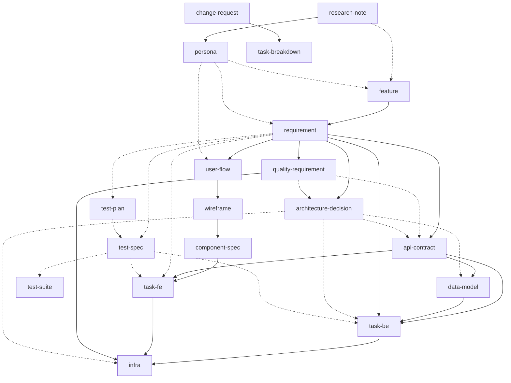

# Artifact Dependency Graph — Quick Reference

## Notation

| Symbol | Meaning |
|---|---|
| solid arrow `-->` | Hard dependency — blocking; artifact cannot reach `accepted` without this dep existing and accepted |
| dashed arrow `-.->` | Soft dependency — recommended; missing generates warning only, does not block |

## Dependency Graph

## Dependency Rules Per Artifact

| Artifact | Hard-deps ● | Soft-deps ○ | Blocks |
|---|---|---|---|
| `research-note` | — | — | `persona` |
| `persona` | `research-note` | — | `requirement`, `user-flow` |
| `feature` | — | `research-note`, `persona` | `requirement` |
| `requirement` | `feature` | `persona` | `quality-requirement`, `user-flow`, `adr`, `api-contract`, `task-be` |
| `quality-requirement` | `requirement` | — | `adr`, `api-contract`, `infra` |
| `architecture-decision` | `requirement` | `quality-requirement` | `api-contract`, `data-model` |
| `user-flow` | `requirement` | `persona` | `wireframe` |
| `wireframe` | `user-flow` | — | `component-spec` |
| `component-spec` | `wireframe` | — | `task-fe` |
| `api-contract` | `requirement` | `adr`, `quality-requirement` | `data-model`, `task-be`, `task-fe` |
| `data-model` | `api-contract` | `adr` | `task-be` |
| `test-plan` | — | `requirement` | (soft path only — blocks nothing) |
| `test-spec` | — | `requirement`, `test-plan` | (soft path only — blocks nothing) |
| `test-suite` | — | `test-spec`, `test-plan` | (soft path only — blocks nothing) |
| `task-be` | `api-contract`, `data-model`, `requirement` | `adr`, `test-spec` | `infra` |
| `task-fe` | `component-spec`, `api-contract` | `requirement`, `test-spec` | `infra` |
| `task-breakdown` | `change-request` (status: applied) | — | tasks within it |
| `infra` | `task-be` (all done), `task-fe` (all done), `quality-requirement` | `adr` | — (terminal) |
| `change-request` | target artifact | — | — |
| `advisory` | — | concern artifact | — (orchestrator note only) |
| `milestone` | — | `requirement`, `task`, `change-request` | — (coordination only) |

## Task Metadata Fields

Tasks carry additional frontmatter beyond standard hard/soft deps:

| Field | Required | Purpose |
|---|---|---|
| `scenario` | recommended | Links task to `req-{slug}#scenario-N`; used for scenario completion queries and traceability |
| `milestone` | optional | Sprint/phase assignment (`milestone-{slug}`) |
| `estimated-hours` | optional | Effort estimate for timeline planning |
| `depends-on` | when applicable | Other task IDs this task waits for — determines tier ordering within a track |

## Enforcement Triggers

| Event | What runs |
|---|---|
| Status → `accepted` | Validate all hard-deps exist and are `accepted`; check acyclicity |
| Accepted artifact updated | Traverse forward through hard-dep graph; mark downstream `accepted` artifacts `needs-review` |
| Phase transition requested | Check all hard-deps for next layer exist and are `accepted`; block or allow |
| User describes a change | Traverse impact depth; route to Small / Medium / Large track |
