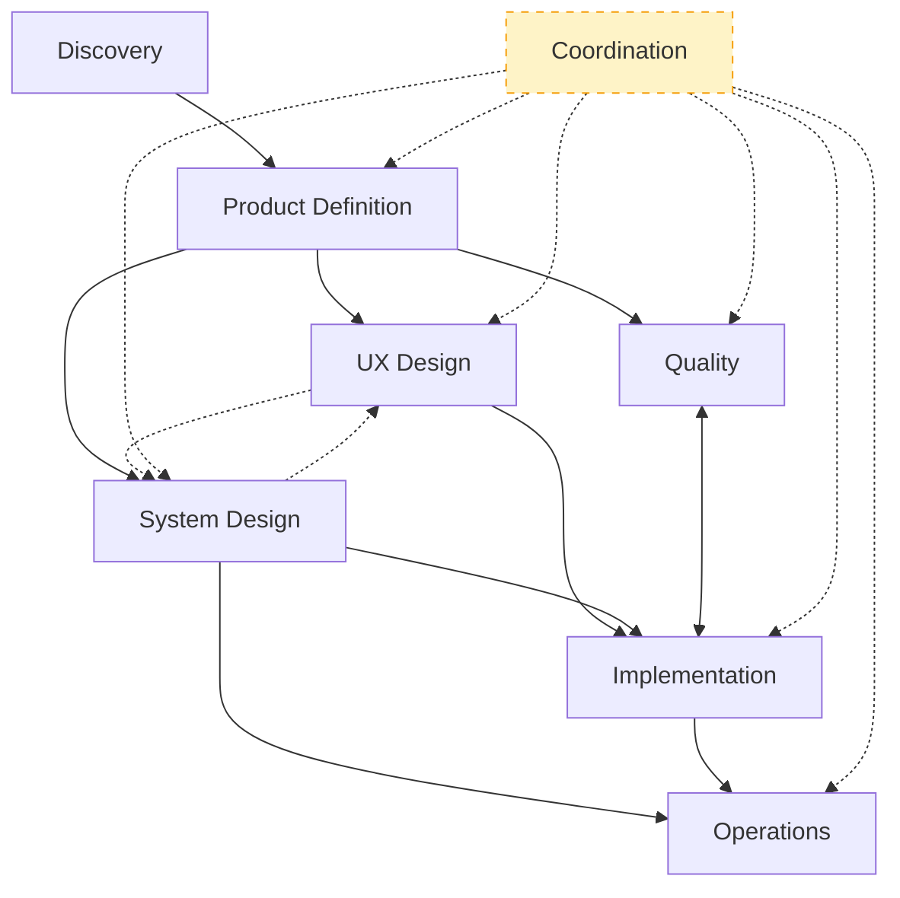
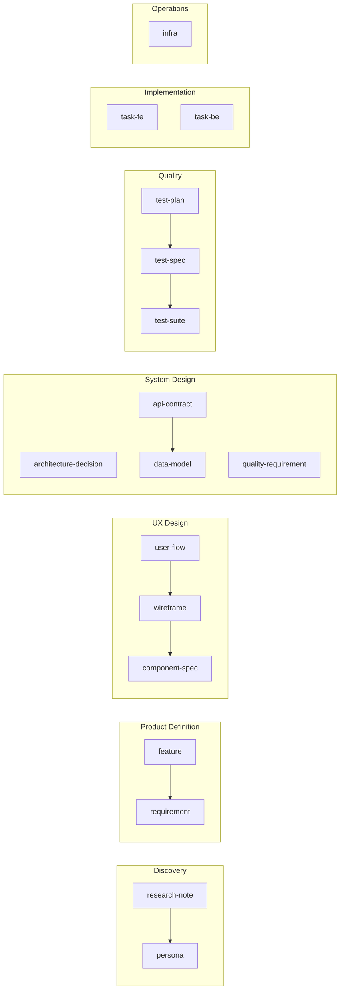

# Artifact Dependency Graph
> Groups, group flow, inter-group interactions, intra-group dependencies, creation order. Not enforced. Narrative: `../handbook/artifact-dependency-graph.md`.

## Groups

| Group | Artifacts | Question |
|---|---|---|
| Discovery | research-note, persona | Who? |
| Product Definition | feature, requirement | What? |
| UX Design | user-flow, wireframe, component-spec | How does the user experience it? |
| System Design | architecture-decision, quality-requirement, api-contract, data-model | How is it structured? |
| Quality | test-plan, test-spec, test-suite | How do we know it works? |
| Implementation | task-fe, task-be | Build it |
| Operations | infra | Run it |
| Coordination *(overlay)* | change-request, advisory, milestone | Cross-cutting |

## Group Flow

Solid = produces; double = co-evolves; dashed = overlay or optional co-evolution.

## Interaction Types

| Type | Symbol | Meaning |
|---|---|---|
| Produces | `A → B` | A required before B |
| Refines | `A ↩ B` | B exposes gap in A; revise via CR |
| Constrains | `A ⊳ B` | A bounds B's valid shape |
| Validates | `A ⊨ B` | B asserts A correct/testable |
| Co-evolves | `A ↔ B` | iterated together |

## Inter-Group Matrix

| From → To | Produces | Refines | Constrains | Validates | Co-evolves |
|---|---|---|---|---|---|
| Discovery → PD | research/persona → feature, requirement | gaps → new research-note | persona scopes audience | | |
| PD → UX | requirement → user-flow | edge cases → requirement | persona scopes flow | | |
| PD → SD | requirement → ADR, api-contract | infeasibility → CR | quality-requirement bounds SD | | |
| PD → Q | requirement → test-plan, test-spec | untestable → rewrite | | test-spec proves testable | |
| UX ↔ SD *(optional)* | | api shape vs UX needs | data-model limits UX surface | | component-spec ↔ api-contract (when run in parallel) |
| UX → Q | user-flow → e2e test-spec | | | test-suite verifies flow | |
| SD → Q | api-contract → contract test | | | test-suite verifies contract/model | |
| UX → IMPL | component-spec → task-fe | impl reveals design gap → CR | | | |
| SD → IMPL | api-contract → task-fe/be; data-model → task-be | impl reveals contract gap → CR | ADR constrains tech choices | | |
| Q ↔ IMPL | test-spec → task (TDD) | failing test → fix code or spec | | test-suite gates task done | tests & tasks iterated together |
| SD → OPS | quality-requirement → infra SLA | runtime breach → quality-requirement CR | ADR binds infra (e.g. postgres) | | |
| IMPL → OPS | tasks done → infra deploy | prod issue → task CR | | | |
| Coordination ⟂ all | milestone groups artifacts | CR reopens any artifact | advisory flags future constraint | | |

Q ↔ IMPL mechanics: see `../handbook/tdd-workflow.md`.

## Intra-Group Dependencies

## Creation Order

| To create… | First create… |
|---|---|
| persona | research-note |
| feature | (entry point) |
| requirement | feature |
| quality-requirement | requirement |
| architecture-decision | requirement |
| user-flow | requirement |
| wireframe | user-flow |
| component-spec | wireframe |
| api-contract | requirement |
| data-model | api-contract |
| test-plan | requirement |
| test-spec | requirement (+ test-plan) |
| test-suite | test-spec |
| task-be | api-contract, data-model, requirement |
| task-fe | component-spec, api-contract |
| infra | tasks complete + quality-requirement |
| change-request | target artifact |
| advisory | (none) |
| milestone | (none) |

Cross-refs live in `refs` frontmatter. See `artifact-frontmatter.md`.
