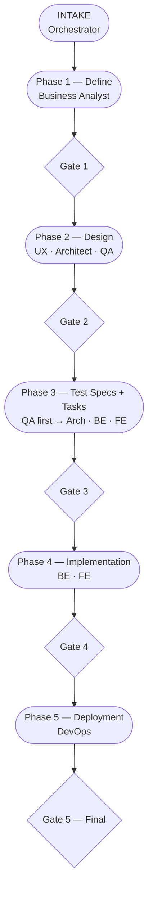

# SDLC Phases — Quick Reference

## Phase Flow

## Phase Summary

| Phase | Agents | Artifacts produced | Gate condition |
|---|---|---|---|
| INTAKE | orchestrator | `feature` | — |
| 1 — Define | business-analyst | `requirement` (with scenarios) | all scenarios have AC + priority; scope defined |
| 2 — Design | ux-ui-designer, software-architect, qa-engineer | `user-flow`, `wireframe`, `component-spec`, `adr`, `api-contract`, `data-model`, `quality-requirement`, `test-plan` | expected upstream artifacts accepted; concerns noted as advisories |
| 3 — Test + Tasks | qa-engineer (first), software-architect, backend-engineer, frontend-engineer | `test-spec`, `test-suite`, `task-be`, `task-fe` | test spec per scenario; task list with tiers presented |
| 4 — Implementation | backend-engineer, frontend-engineer | task status updates, `change-request` | all tasks done or explicitly deferred; open CRs resolved or deferred |
| 5 — Deployment | devops-engineer | `infra` | infra plan approved; all deferred items surfaced to user |

## Track Selection

| Impact depth | Track | Entry point | Gates |
|---|---|---|---|
| 1–2 artifact layers | Small — CR only | specific artifact | 1 |
| 3–4 artifact layers | Medium — partial SDLC | requirement or design artifact | 2–3 |
| 5+ artifact layers | Large — full SDLC | feature or requirement | 5 |

Track is determined by dep graph traversal — not manual classification. Orchestrator traverses the dep graph forward and backward from the entry point artifact and counts affected layers.

## Parallel Execution Windows

| Phase | Default sequencing | Can run in parallel when |
|---|---|---|
| Phase 2 | UX → Architect → QA | user explicitly requests it; no blocking dep between agents at that point |
| Phase 3 | QA specs first, then Arch/BE/FE | QA must complete specs before task decomp starts; Arch/BE/FE can then run in parallel |
| Phase 4 | BE → FE | user explicitly requests it |

## QA Phase Anchors

| Artifact | Created in | Trigger | Owner |
|---|---|---|---|
| `test-plan` | Phase 2 | After requirements accepted; parallel with UX/Arch | qa-engineer |
| `test-spec` | Phase 3 | After api-contracts + data-models accepted; before task decomp | qa-engineer |
| `test-suite` | Phase 3 | After related test-specs drafted | qa-engineer |
| `test-spec` → `accepted` | Phase 4 | QA confirms all test cases pass after implementation | qa-engineer |
| `test-suite` → `accepted` | Phase 4 | When all included test-specs are accepted | qa-engineer |

## PKM Writes Per Phase

| Phase | Artifact types written |
|---|---|
| INTAKE | `feature` |
| Phase 1 | `requirement` (with embedded scenarios) |
| Phase 2 | `user-flow`, `wireframe`, `component-spec`, `adr`, `api-contract`, `data-model`, `quality-requirement`, `test-plan` |
| Phase 3 | `test-spec`, `test-suite`, `task-be`, `task-fe` |
| Phase 4 | task status + task Implementation Notes section, `change-request`; test artifacts → `accepted` |
| Phase 5 | `infra` |
| Any phase | `advisory` (noted concerns), `change-request` (gaps in existing artifacts), `milestone` (optional timeline) |
