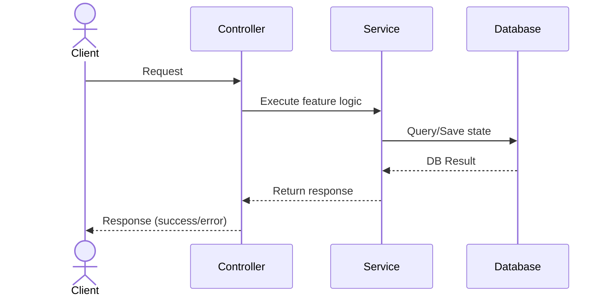
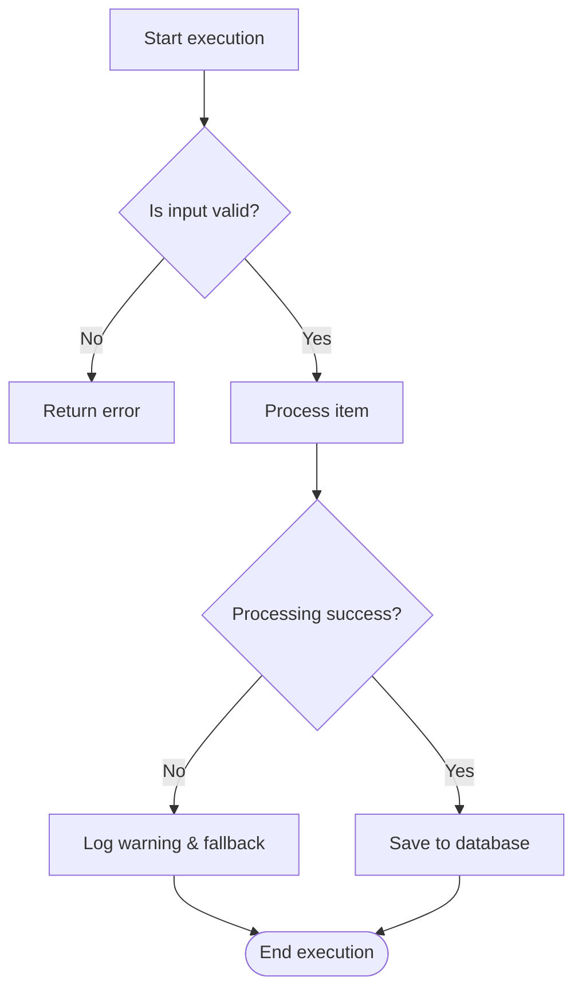

# Technical Design: {title}

## Overview
<!-- What this document covers and why it exists. One paragraph. -->

## Scope
<!-- What is and is not covered by this design. -->

## Architectural Context
<!-- References to ADR or system-architecture artifacts that constrain or are updated by this design.
     - Top-down: reference existing ADRs/system-architectures that constrain this design.
     - Bottom-up: draft proposed architectural shifts here, then formalize them by authoring/updating standalone adr-{slug}.md or system-architecture artifacts. -->

| ADR | Impact on This Feature |
|---|---|
| {adr-link}: {ADR title} | {how it constrains this feature} |

## Component Interaction & Flow
<!-- Visualizations detailing how this feature is executed. 
     Use either or both diagrams depending on feature complexity:
     - Component Interaction (C4 L3): Use a Sequence Diagram to show coordination between internal components/services.
     - Process Flow (C4 L4): Use a Flowchart to show complex conditional logic, data pipelines, or step-by-step processing inside a component.
     - Top-down: align with system-architecture. Bottom-up: use this flow to inform updates to system-architecture. -->

### Component Interaction (C4 L3)

### Process Flow (C4 L4)

## Key Decisions
<!-- Feature-scoped implementation decisions.
     - Top-down: decisions must align with and reference constraints in system-architecture.
     - Bottom-up: use this section to propose new structural patterns that may later be promoted to system-wide ADRs. -->

| Decision | Choice | Reason | Constrained by |
|---|---|---|---|
|   |   |   | {sa-id} |

## Observability & Instrumentation
<!-- How are we tracking the Success Metrics defined in the PRD? What logs/events are we emitting? -->
- **Events:** `event_name` (Properties: `prop1`, `prop2`)
- **Monitors/Alerts:** {What should page us if this feature breaks?}

## Deployment & Rollout Strategy
<!-- Feature flags, environment variables, dark launches, and migration steps. -->
- **Feature Flag:** `flag-name` (default: false)
- **Rollout Plan:** {e.g., Enable for internal users -> 10% -> 100%}
- **Rollback Plan:** {How do we revert if it causes an incident?}

## Implementation Plan
<!-- Ordered steps or phases. Each step should map 1:1 to a task artifact. -->

### 1. {Step Title} — `task-{slug}`
- **Prerequisites:** {None, or dependent step/task IDs}
- **Inputs:** {Trigger conditions, inputs, configuration, or raw data shapes}
- **Outputs:** {Expected output, changes, DB state changes, or returned values}
- **Details:** {Specific classes, functions, or configurations to touch}

### 2. {Step Title} — `task-{slug}`
- **Prerequisites:**
- **Inputs:**
- **Outputs:**
- **Details:**

## Cross-Feature & System Impact
<!-- Evaluate how this technical design affects other parts of the system or existing features. -->
- **Backward Compatibility:** {Does this introduce breaking changes to existing APIs, events, database schemas, or configurations?}
- **Downstream/Cross-Feature Effects:** {Which existing features, frontend views, event consumers, or offline jobs are impacted by these changes?}
- **Performance & Resource Impact:** {Any expected changes to database query load, API latency, memory/CPU footprint, or storage?}
- **Migration & Backfill Dependencies:** {Are there dependencies on existing data migration timelines or asynchronous backfills?}

## Edge Cases & Error Handling
<!-- Known edge cases and how they are handled. -->

## Open Questions
<!-- Unresolved items that must be answered before tasks can start. -->
- [ ] 

## Definition of Done
<!-- The software-architect agent checks these before flipping status to ready-for-review. -->
- [ ] Architectural Context references accepted ADRs only
- [ ] Key Decisions are feature-scoped (system-wide decisions belong in ADRs)
- [ ] Component Interaction & Flow diagrams represent this feature's logic and omit system-wide architecture
- [ ] Implementation Plan steps specify prerequisites, inputs, and outputs and map 1:1 to task artifacts
- [ ] Cross-Feature & System Impact section is fully evaluated and addressed
- [ ] Affected user-stories flagged as needs-review if acceptance criteria or inter-story dependencies must change

## References
- {sa-link}
- {api-link}
- {dd-link}
- {feature-link}
